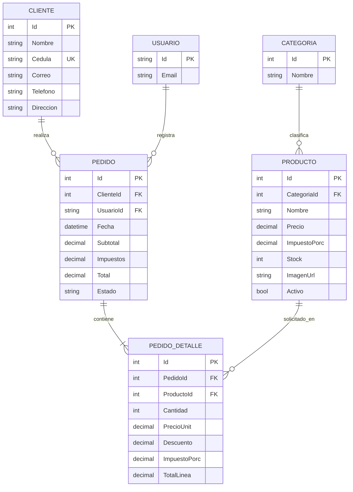

# Modelo entidad-relación y normalización

## Decisiones de diseño

- **Primera forma normal:** todos los atributos son atómicos; los detalles del pedido se separan de su encabezado.
- **Segunda forma normal:** los datos del producto y del cliente no se repiten por línea de pedido. Cada detalle depende de su identificador.
- **Tercera forma normal:** la categoría se almacena una vez y se referencia por clave foránea; se evita repetir su nombre en Producto. La cédula del cliente es única.
- Los importes de `Pedido` y `PedidoDetalle` se persistirán en el segundo hito para auditoría, aunque se calculen a partir de las líneas.

## Integridad

- Producto requiere categoría existente y no permite stock negativo.
- Cliente impide identificaciones duplicadas.
- La relación Producto-Categoría restringe eliminar una categoría que tenga productos.
